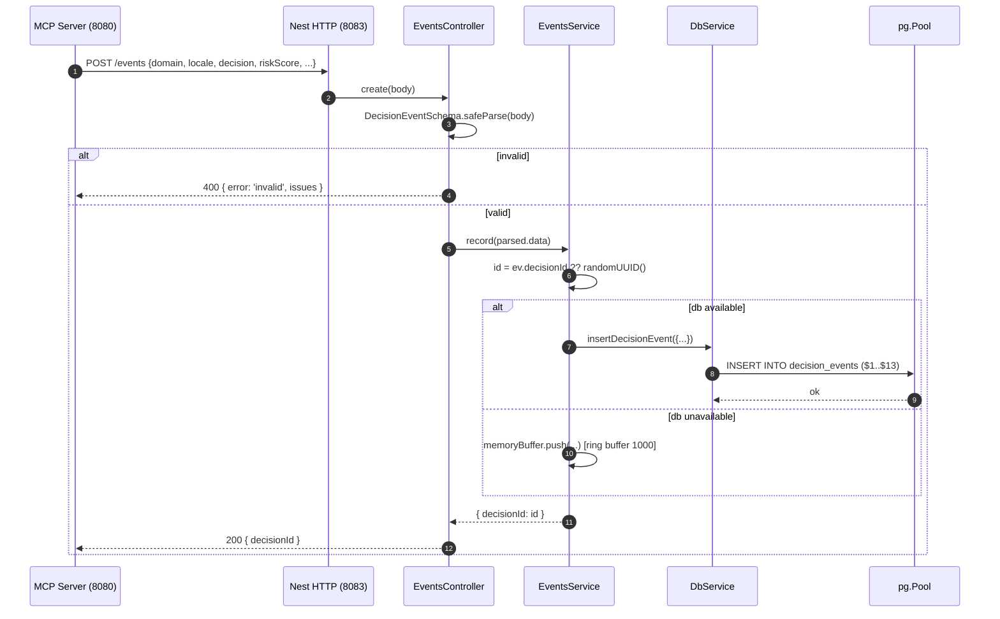
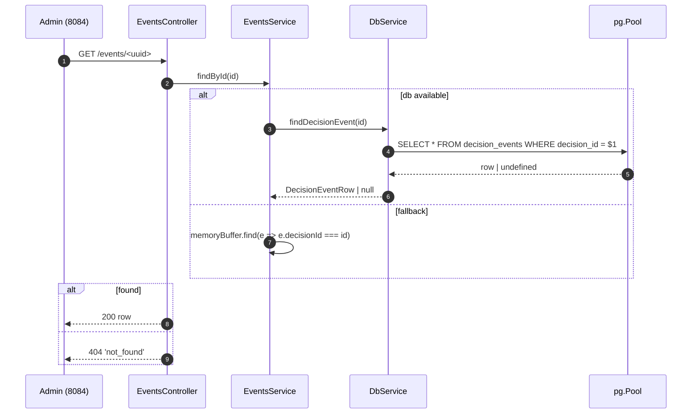
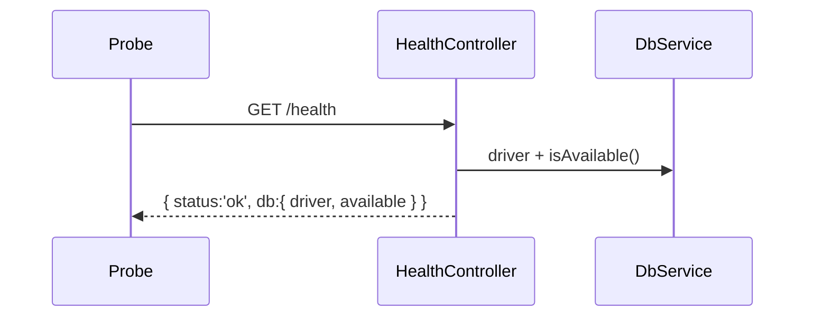

# CODE-REVIEW-Lv2 — Guardrails Audit Service

| 항목 | 값 |
| :-- | :-- |
| 분석일 | 2026-05-20 |
| 대상 | `/Users/wise/Developer/Web(Node,Script)/Guardrails-Service-Audit-Service` |
| 리뷰 레벨 | 2 (라인별 의미·실수 패턴·라이브러리 동작) |
| 선택/전체 | 전체 소스 (10 / 10 TS, +manifests) |
| 분석 Claude | Opus 4.7 (1M context) |

---

## 1. Workspace Inventory

### 1.1 Directory tree (depth 4, excluded defaults)

```
.
├── .dockerignore
├── .env.example
├── .gitignore
├── .omc/                     # 비어있음 (sibling 리뷰 캐시용)
├── Dockerfile
├── README.md
├── nest-cli.json
├── package.json
├── tsconfig.json
└── src/
    ├── app.module.ts
    ├── main.ts
    ├── db/
    │   ├── db.module.ts
    │   ├── db.service.ts
    │   └── schema.sqlite.ts
    ├── events/
    │   ├── events.controller.ts
    │   ├── events.module.ts
    │   ├── events.service.ts
    │   └── events.types.ts
    └── health/
        └── health.controller.ts
```

### 1.2 File counts

| 디렉토리 | TS | SQL | 총 LOC |
| :-- | --: | --: | --: |
| `src/` (root) | 2 | 0 | 23 |
| `src/db/` | 3 | 0 (embedded in TS) | 244 |
| `src/events/` | 4 | 0 | 105 |
| `src/health/` | 1 | 0 | 11 |
| **합계** | **10** | **0** | **383** (코드 라인, 빈줄 포함시 406) |

언어: 100% TypeScript. README에 언급된 `scripts/init-db.sql`은 **본 저장소에 존재하지 않음** (별도 인프라 저장소 또는 sibling repo 추정).

### 1.3 Build manifests

| 파일 | 핵심 내용 |
| :-- | :-- |
| `package.json` | Nest 10.3.0, pg ^8.11.5, better-sqlite3 ^11.0.0, zod ^3.22.4, TS ^5.4.0 |
| `tsconfig.json` | `target=ES2022`, `strict=true`, `module=commonjs`, `emitDecoratorMetadata=true` |
| `nest-cli.json` | `sourceRoot=src`, `deleteOutDir=true` |
| `Dockerfile` | 멀티스테이지 node:20-alpine, build→runtime, EXPOSE 8083 |

### 1.4 Lockfiles
**확인 불가 — 파일 부재** (`package-lock.json`/`pnpm-lock.yaml`/`yarn.lock` 없음). 재현 가능한 빌드를 막는 빈틈.

### 1.5 Entry-point candidates

- `src/main.ts` — NestFactory.bootstrap, port 8083, `app.enableShutdownHooks()`
- `dist/main.js` — `package.json#main`, 운영 진입점

### 1.6 Test directories
**없음.** `jest` 설정은 `package.json`에 정의되어 있으나 `.spec.ts` 파일 0개. README에 테스트 가이드 부재.

---

## 2. Project Structure

### 2.1 Source tree (역할 주석)

```
src/
├── main.ts                          # NestFactory bootstrap, 0.0.0.0:8083 listen, shutdown hooks
├── app.module.ts                    # ConfigModule(global) + DbModule(global) + EventsModule, HealthController 등록
├── db/
│   ├── db.module.ts                 # @Global() — DbService 전역 export
│   ├── db.service.ts                # Postgres/SQLite 듀얼 드라이버, insert/find/recent 3 API, lifecycle hooks
│   └── schema.sqlite.ts             # SQLite CREATE TABLE/INDEX DDL 상수 (BLOB·JSON-TEXT 매핑)
├── events/
│   ├── events.module.ts             # 컨트롤러+서비스 묶음, EventsService export (외부 모듈 미사용)
│   ├── events.types.ts              # zod DecisionEventSchema + 추론 타입
│   ├── events.service.ts            # DB 가용/불가용 분기, in-memory ring buffer fallback (1000건)
│   └── events.controller.ts         # POST /events, GET /events, GET /events/:id
└── health/
    └── health.controller.ts         # GET /health → { status, db: { driver, available } }
```

### 2.2 Module dependency graph

```mermaid
graph TD
    Main[main.ts] --> AppModule
    AppModule --> ConfigModule[@nestjs/config]
    AppModule --> DbModule
    AppModule --> EventsModule
    AppModule --> HealthController

    DbModule -. provides .-> DbService
    EventsModule --> EventsController
    EventsModule --> EventsService
    EventsService --> DbService
    EventsController --> EventsService
    EventsController --> DecisionEventSchema[events.types: zod]

    HealthController --> DbService
    DbService --> Pool[pg.Pool]
    DbService --> Sqlite[better-sqlite3 (dynamic import)]
    DbService --> Schema[schema.sqlite.ts]
```

핵심 의존: `DbService`가 sink, `EventsService`/`HealthController`가 동일 facade에 의존. `@Global()` 데코레이터 덕에 `EventsModule`은 `DbModule`을 imports하지 않아도 됨.

### 2.3 Call & response flow

#### Flow A — POST /events (가장 빈번한 경로)



#### Flow B — GET /events/:id



#### Flow C — GET /health



`status`는 항상 `'ok'` (DB 미가용에도 200). 액티브 헬스체크 의도라면 비치명 신호로 분리 — §4의 위험 핫스팟 참고.

### 2.4 Third-party package inventory

| 패키지 | 버전 | 사용처 | 역할 | 라이선스 (npm 일반) |
| :-- | :-- | :-- | :-- | :-- |
| `@nestjs/common` | ^10.3.0 | 전 파일 데코레이터 | DI, HTTP, Logger | MIT |
| `@nestjs/core` | ^10.3.0 | `main.ts` | NestFactory | MIT |
| `@nestjs/platform-express` | ^10.3.0 | 암묵 (HTTP 어댑터) | Express bridge | MIT |
| `@nestjs/config` | ^3.2.0 | `app.module.ts` | `ConfigModule.forRoot` (env 로드) | MIT |
| `pg` | ^8.11.5 | `db.service.ts` | Postgres Pool/Query | MIT |
| `better-sqlite3` | ^11.0.0 | `db.service.ts` (dynamic import) | 동기 SQLite 드라이버 | MIT |
| `zod` | ^3.22.4 | `events.types.ts`, `events.controller.ts` | 페이로드 검증 | MIT |
| `reflect-metadata` | ^0.2.0 | 암묵 (Nest 데코레이터) | 메타데이터 emit | Apache-2.0 |
| `rxjs` | ^7.8.1 | 의존성으로만 (직접 미사용) | Nest 내부 | Apache-2.0 |
| (dev) `jest`, `ts-jest`, `@types/*` | — | 설정만 존재 | 테스트 부재 | MIT |

### 2.5 Data flow & state stores

| 저장소 | 위치 | 모드 | 스키마 |
| :-- | :-- | :-- | :-- |
| Postgres `decision_events` | `pg.Pool`, env-driven | 운영 기본 | README 인용 (이 저장소 외부에서 DDL 적용 가정) |
| SQLite `decision_events` | `./var/audit.db` 기본 | `DB_DRIVER=sqlite` 시 | `schema.sqlite.ts` 내부 DDL (idempotent `CREATE TABLE IF NOT EXISTS`) |
| In-memory ring buffer | `EventsService.memoryBuffer` | DB 미가용 시 | `DecisionEvent[]`, 길이 ≤ 1000 (shift 기반 FIFO) |

설정 소스: `process.env` 직접 참조 (Nest `ConfigService`는 import만 되고 사용되지 않음). I/O: HTTP in, DB out, 디스크(`./var/audit.db`) 또는 메모리 buffer.

### 2.6 Numbered entrypoint list

1. **`POST /events`** — MCP Server가 매 판정마다 호출하는 적재 API (필수 hot-path).
2. **`GET /events/:id`** — Admin/MCP `explain_decision` 백엔드.
3. **`GET /events?limit=N`** — Admin 대시보드 최근 목록.
4. **`GET /health`** — 컨테이너/오케스트레이터 헬스 프로브.
5. (lifecycle) **`onModuleInit` / `onModuleDestroy`** — 드라이버 열기/풀 종료.

---

## 3. File Selection

전체 10개 TS 모두 선정 (cap 40 미만, max-files 무관). 우선순위:

1. `src/main.ts` (진입점, distance 0)
2. `src/app.module.ts` (distance 1)
3. `src/db/db.service.ts` (가장 큰 파일, distance 2, in-degree 2)
4. `src/events/events.controller.ts` (HTTP 진입)
5. `src/events/events.service.ts`
6. `src/events/events.types.ts`
7. `src/db/db.module.ts`
8. `src/events/events.module.ts`
9. `src/db/schema.sqlite.ts`
10. `src/health/health.controller.ts`

세부 분석은 `.review/CODE-REVIEW-Lv2/src/<dir>/<file>.ts.md` 참조.

---

## 4. Whole-Codebase Synthesis

### 4.1 반복 패턴

- **Driver-neutral facade** (`DbService`): 동일 메서드를 `if (driver === 'sqlite') {...} else {...}`로 2회 작성. Policy-Engine `DbService`와 동일 패턴 (코드 주석에서 명시). 장점: 0-config 로컬 개발. 단점: SQL이 두 곳에 중복되어 컬럼 추가 시 두 분기 모두 수정 필요.
- **Zod 입력 검증**: 컨트롤러 진입에서 `safeParse` + `flatten()`으로 400 응답. 검증 후의 타입은 `z.infer` 추론. 컨트롤러는 1곳뿐이라 일관성 유지 쉬움.
- **Optional fields with `?? null` coalescing**: `tenantId ?? null` 패턴이 `db.service.ts`에서 반복. 누락 검사를 한 자리에 집중.
- **DB-unavailable fallback**: `EventsService`에서 `db.isAvailable()` 분기로 메모리 버퍼 사용. 같은 분기가 `record`, `findById`, `recent` 3곳에 산재 — 추상화 여지.

### 4.2 계층 위반

- **`HealthController`가 `DbService.driver`(private 멤버 아닌 readonly 필드) 직접 읽기**: 노출이 의도이긴 하나, 헬스 도메인이 인프라 디테일(드라이버 이름)을 응답에 포함시킴. 클라이언트가 이를 SLO 키로 쓰기 시작하면 lock-in 발생.
- **`DbService.driver`가 `public readonly`**: facade임에도 외부에서 분기 가능. 현재는 read-only 정보 표시용으로만 사용되어 우려 수준은 낮음.
- **`ConfigModule`은 글로벌로 로드되지만 누구도 `ConfigService`를 주입하지 않음**: `process.env` 직접 사용. ConfigModule 도입의 효익(검증, .env override layering)을 활용하지 못함.

### 4.3 위험 핫스팟 Top-5

| # | 위치 | 위험 | 영향 |
| :--: | :-- | :-- | :-- |
| 1 | `events.service.ts:43-51` (memoryBuffer find by `decisionId`) | DB 복구 후 메모리에 쌓인 이벤트가 **drain되지 않음**. 동일 ID 조회가 DB↔메모리 사이에서 일관성 잃음. | 데이터 유실/조회 불일치 |
| 2 | `main.ts:8` `Number(process.env.PORT ?? 8083)` | PORT가 `"abc"`면 `NaN`으로 listen → `ERR_SOCKET_BAD_PORT`. 잘못된 ENV에서 silent crash. | 부팅 실패 진단 비용 |
| 3 | `db.service.ts:86-93` | Postgres 비밀번호 기본값 `'guardrails'` 하드코딩. 실배포에서 env 누락 시 약한 자격증명으로 접속 시도. | 정보보안 |
| 4 | `health.controller.ts:8-10` | DB 미가용에도 `status:'ok'` 반환 — k8s liveness/readiness 분리 없으면 트래픽이 계속 흘러들어 in-memory ring으로 빠짐 (운영에서는 의도 미상). | 알람 누락 |
| 5 | `events.controller.ts:26-28` | `Math.min(Number(limit), 1000)`: `limit="abc"` → `NaN` → `Math.min(NaN, 1000) = NaN` → SQL LIMIT $1에 NaN 전달, pg가 `invalid input syntax`로 500. 입력 검증 누락. | UX/에러 분류 |

### 4.4 삭제 후보

- `rxjs` 직접 사용 없음 (Nest 내부 의존). 제거 불가. — 삭제 아님.
- `package.json#jest` 설정 — 테스트 0개이므로 **테스트 추가 또는 설정 제거** 양자택일 권고.
- `app.module.ts` 의 `ConfigModule.forRoot({ isGlobal: true })` — `ConfigService` 미사용. 현재 가치는 `.env` 자동 로드뿐. 명시적 의도라면 주석 보강.

### 4.5 테스트 공백

- `.spec.ts` 0개. Audit-Service의 SLA(데이터 유실 0)에 비해 매우 낮은 커버리지.
- 최소 권고 스펙:
  - `events.controller.spec.ts`: zod 실패 → 400, 정상 → 200, decisionId 자동 발급.
  - `events.service.spec.ts`: DB 미가용 시 메모리 fallback, 1000 초과 시 FIFO.
  - `db.service.spec.ts` (sqlite 한정): insert→find round-trip, recent 정렬.

### 4.6 다음 단계 권고

1. **메모리 버퍼 drain 로직** — DB 복구 감지 시 일괄 INSERT. 또는 fallback을 명시적으로 거부(503)로 바꾸고 메모리 버퍼 제거.
2. **입력 검증 강화** — `limit` 파라미터를 zod로 검증(`z.coerce.number().int().min(1).max(1000)`).
3. **자격증명 보안** — `POSTGRES_PASSWORD` 누락 시 fail-fast.
4. **헬스/레디니스 분리** — `/health/live`(항상 ok), `/health/ready`(db.available 반영).
5. **테스트 도입** — 최소 3 스펙 추가.
6. **Lockfile 커밋** — 재현 가능한 빌드.

---

## 5. Appendices

### Appendix A — Deferred items
- `scripts/init-db.sql` 실제 내용 분석 (저장소 외부)
- Policy-Engine `DbService` 와의 코드 일치도 비교
- Postgres 실제 인덱스/RLS 적용 여부

### Appendix B — Full file map

| 경로 | LOC | 리뷰 파일 |
| :-- | --: | :-- |
| `src/main.ts` | 12 | `src/main.ts.md` |
| `src/app.module.ts` | 11 | `src/app.module.ts.md` |
| `src/db/db.module.ts` | 6 | `src/db/db.module.ts.md` |
| `src/db/db.service.ts` | 206 | `src/db/db.service.ts.md` |
| `src/db/schema.sqlite.ts` | 32 | `src/db/schema.sqlite.ts.md` |
| `src/events/events.controller.ts` | 29 | `src/events/events.controller.ts.md` |
| `src/events/events.module.ts` | 6 | `src/events/events.module.ts.md` |
| `src/events/events.service.ts` | 52 | `src/events/events.service.ts.md` |
| `src/events/events.types.ts` | 18 | `src/events/events.types.ts.md` |
| `src/health/health.controller.ts` | 11 | `src/health/health.controller.ts.md` |
